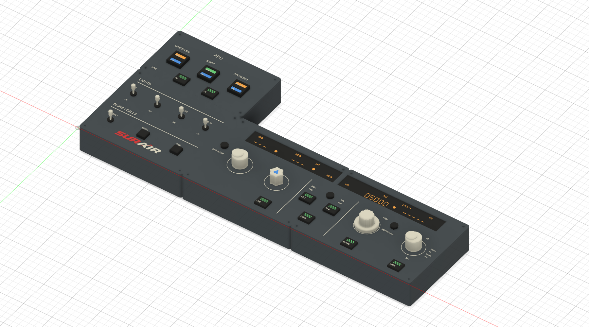

# SUR Air panel

Modular SUR Air desktop hardware for Microsoft Flight Simulator, with a
400 mm FlyByWire A32NX A320neo FCU layout and LED-ready APU controls.

Start with [hardware](hardware/README.md): editable Fusion 360 archives,
printable parts, and the reproducible CAD source. Software and simulator
integration will follow after the physical controls are selected.

For multicolor printing, use [hardware/multicolor](hardware/multicolor):
aligned multipart 3MF faceplates with separate panel, text, and logo colors.
