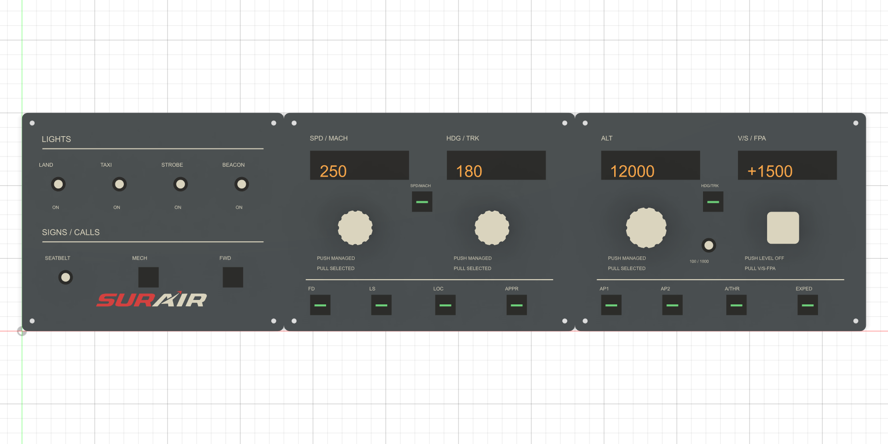

# Hardware - Airbus-inspired SUR Air panel

This revision matches the **FlyByWire A32NX A320neo FCU layout at 400 mm
wide**, with printable geometry and provisional electronics interfaces.
It is a scaled cockpit-layout reproduction, not a certified dimensional
replica or a finished electronics assembly.



[Isometric assembly view](assembly-isometric.png)

## Layout

Four independently printable modules form a **580 x 250 mm** desktop
panel. The faceplates are 3 mm thick; rear trays are 42 mm deep with 3 mm
walls. The APU module attaches above the lights/signs module. No individual
exported part exceeds a conservative 220 x 220 mm
footprint, leaving ample room on the H2C for a brim.

| Module | Faceplate | Controls |
|---|---|---|
| Lights and signs | 180 x 150 mm | LAND, TAXI, STROBE, BEACON; SEATBELT; MECH and FWD call buttons |
| FCU speed and heading | 190 x 150 mm | SPD and HDG display strip; SPD/MACH button; speed and heading knobs; LOC; AP1 |
| FCU altitude and vertical speed | 210 x 150 mm | ALT and V/S display strip; HDG V/S / TRK FPA mode button; AP2, A/THR; concentric 100/1000 selector; METRIC ALT; EXPED; APPR |
| APU and auxiliary EFIS controls | 180 x 100 mm | MASTER SW, START, APU BLEED illuminated pushbuttons; FD and LS |

The FCU reproduces the cockpit's continuous upper display strip, central
AP1/AP2 and A/THR cluster, round mode buttons, LOC/EXPED/APPR positions,
smooth eccentric speed/V/S knobs, lobed heading knob with triangular index,
and scalloped altitude knob inside a separate 100/1000 selector collar.
Generic push/pull instructions were removed from the FCU face; the aircraft's
PUSH TO LEVEL OFF legend remains beside V/S. Display references use amber
seven-segment geometry and managed-mode dots.

FD and LS belong to the aircraft's separate EFIS panel, not the FCU.
They are retained as auxiliary controls on the APU module without changing
the cockpit FCU layout. The actual red/white SUR Air website logo remains
raised on the lights/signs faceplate.

References: [A32NX FCU](https://docs.flybywiresim.com/pilots-corner/a32nx/a32nx-briefing/flight-deck/glareshield/fcu/),
[APU](https://docs.flybywiresim.com/pilots-corner/a32nx/a32nx-briefing/flight-deck/ovhd/apu/),
and [APU bleed](https://docs.flybywiresim.com/pilots-corner/a32nx/a32nx-briefing/flight-deck/ovhd/ac/).
The front layout follows the FCU image linked by the official documentation.
The 400 mm width, split faceplates, provisional bores, and raised printed
legends are intentional manufacturing adaptations.

## Illuminated APU controls

| Pushbutton | Upper annunciator | Lower annunciator |
|---|---|---|
| MASTER SW | Amber FAULT | Blue ON |
| START | Green AVAIL | Blue ON |
| APU BLEED | Amber FAULT | Blue ON |

Each printable cap has two separated optical bays, two 3.2 mm rear LED
bores, and two independently printable diffusers. The central partition
limits light bleed between states. Annunciator text is raised on the
diffusers, not bonded across the cap's light openings.

APU BLEED follows the A32NX's blue ON indication, not a white OFF indicator.
These windows show where the lights go; hardware, current-limiting drivers,
and simulator-controlled illumination remain to be installed. Do not wire
all indicators together: START ON and AVAIL represent different states.

MECH and FWD are treated as momentary calls, not maintained cabin signs.
The initial switches are simple ON/OFF references; Airbus three-position
switch behavior can be added once switch models and simulator mappings
are selected.

## Files

- `sur-air-panel-assembly.f3d`: native editable assembly, including all modules.
- `01-*.f3d`, `02-*.f3d`, `03-*.f3d`, `06-*.f3d`: individual module archives.
- `04-*.f3d`: four printable knob designs and altitude selector collar.
- `05-*.f3d`: rear joining bridges.
- `07-*.f3d`: printable APU caps with separated light bays.
- `08-*.f3d`: six printable, labeled APU diffusers.
- `stl/`: 23 unique parts; print six copies of the bridge.
- `parts.json`: measured dimensions and solid-body information for exported parts.
- `check_exports.py`: verify native archive integrity, STL dimensions and watertightness.
- `build_panel.py`: reproducible Fusion 360 Python source with an editable timeline.
- `assets/sur-air-logo.png`: original logo downloaded from
  <https://www.sur-air.com/img/logo_sur_air_dark.png?v=2>.
- `assets/logo-contours.json`: simplified red/white print geometry.
- `trace_logo.py`: regenerate logo outlines with Python and Pillow.

The logo belongs to SUR Air; no ownership or license is asserted for that asset.

## Provisional parts and interfaces

| Interface | Initial geometry | Selection needed |
|---|---|---|
| Light/seatbelt switches | 6.5 mm bore | Threaded miniature toggle switches and retaining nuts |
| Four FCU encoders | 7.2 mm mounting bore | Encoders with actual push/pull mechanism or a separately designed mechanism |
| Thirteen conventional pushbuttons | 12.2 mm bore | Two call buttons, nine authentic FCU buttons, FD and LS |
| APU caps | Three 24.4 x 24.4 mm apertures | 24 x 24 mm caps; actual switch carriers and travel stops still need designing |
| APU light bays | Two 20 x 8 mm cavities per cap; 3.2 mm LED bores | Six independently driven LEDs and translucent diffusers |
| APU diffusers | 17.6 x 5.6 x 1 mm plus 0.45 mm raised lettering | Translucent filament; fit-test before bonding into light windows |
| Display apertures | 154 x 26 mm and 173 x 26 mm | Display modules/boards or a segmented display carrier |
| Altitude collar | 36 mm outside diameter, 23 mm center clearance | Concentric selector mechanism, two detents and linkage still need designing |
| Knob sockets | 6.2 mm round bore, 14 mm deep | Verify shaft diameter, retention and fit with a small test print |
| Face/tray mounting | Four 3.4 mm through-holes per module | M3 bolts, nuts and washers |
| Rear bridge mounting | Two 3.4 mm holes per bridge | Six bridges and twelve short M3 bolts with nuts |
| Cable routing | One 20 x 10 mm rear exit per module | Cable, strain relief and connectors |

The displayed digits, switch levers and FCU button references
are **visual references**, not purchased hardware or printable functioning
mechanisms. In Fusion, hide the component named
`VISUAL REFERENCES - switches and buttons - NOT PRINTABLE` to inspect the
mounting holes. The APU caps and diffusers are actual printable parts;
their colored appearances illustrate independent indicator colors.
They do not contain electrical components.

The printable knobs alone do not implement FCU push/pull motion.
Electronics, display mounts, APU switch carriers,
encoder retention, switch anti-rotation features and strain relief must
be designed after the actual components are chosen.

## Printing and assembly

### Multicolor without painting

Use the files in **`multicolor/`** instead of the single-body faceplate STLs.
Each `.3mf` contains one aligned assembly with named, independently
assignable material parts:

| Part | Filament assignment |
|---|---|
| Panel - gray blue | Panel filament |
| Text and markings - white | White lettering, rules, dial rings and white AIR logo |
| SUR logo - red | Red SUR lettering and arrow; lights/signs module only |

Open `multicolor/01-lights-and-signs.3mf` in Bambu Studio. If it reports
that the file has no valid printer configuration, choose **load geometry
only**: these are model files, not printer presets. Select your H2C and
add the desired filaments. In **Objects**, expand the panel and assign
each named part to its filament. Existing project filament colors can
make the initial preview look different; map the parts to your own slots.
Do not split, arrange or drop the lettering parts individually: their
coordinates keep them attached to the panel at the correct height.
Save the mapped project as a Bambu Studio `.3mf`.

The other three files provide gray/white separation for both FCU
faceplates and the APU faceplate. `sur-air-color-separated.f3d` in this
folder preserves separate editable solids in Fusion; the original
assembly and single-body STLs remain available.

To regenerate these files, load `export_multicolor.py` in Fusion and call
`export()`. It reopens a copy of the saved assembly, splits the plates
at the 3 mm base surface, preserves body appearances and volume, welds
mesh vertices, and writes the 3MF material groups and Bambu part metadata.
Run `python hardware\check_multicolor.py` to validate the output.

Use gray-blue PETG or PLA for the plates and trays, white for the knobs,
black for the APU caps, translucent filament for the diffusers, and
white/red for the raised legends/logo. The heading index can be painted
blue in the slicer. Faceplate STLs contain the
raised geometry but STL does not retain colors: paint the raised surfaces
in the slicer for a multi-color print, or finish them after printing.

Start with 0.2 mm layers and a 0.4 mm nozzle. Print faceplates with their
flat rear side on the bed, trays with their rear side on the bed, knobs
with their socket openings facing upward, and bridges flat. Inspect thin
legends and the logo in the slicer; use finer layers where needed.

Print one faceplate and tray for each module, one of each knob and the
altitude collar, three APU caps, six translucent diffusers, and six bridges.
Print APU caps rear-side down so the light bays open upward. Print diffusers
flat, lettering upward; opaque white lettering over a translucent base is
optional. Test each optical bay with a separate LED before bonding diffusers.
Use amber LEDs for FAULT, green for AVAIL, and blue for ON; the six
indicators require independent control.

Four bridges join the horizontal panels, and two rotated bridges attach
the APU module above lights/signs. The bridges bolt through adjacent tray
backs; faceplates bolt
through the corner columns. Choose bolt lengths from the measured stack:
corner holes run through the full tray and faceplate, not just the plate.
Mount electronics before closing the trays.

Run a fit coupon before buying/printing the entire set. Bores are starting
dimensions, not verified fits for a particular switch or encoder.

## Regeneration

Run the logo conversion from the repository:

```powershell
python hardware\trace_logo.py
```

In Fusion 360's Python environment, load `build_panel.py` using
`importlib.util.spec_from_file_location`, then call the loaded module's
`build()`. The script creates a **new document**, leaves existing designs
untouched, and exports next to itself. It needs Fusion's appearance library
and the local logo-contour asset; no network access is used during modeling.

Change layout and component dimensions in the source and regenerate when
parts are selected. The timeline is editable, but changes to plate thickness
or layout require checking all dependent offsets, mounting columns and cuts.
This revision does not claim unrestricted parameter-driven resizing.

Check the generated files with **Python 3.14 or newer** (needed for
Fusion's Zstandard-compressed ZIP archives), or load `check_exports.py`
inside Fusion's Python environment and call `check()`:

```powershell
python hardware\check_exports.py
```

In Fusion, also call `check_fusion_design(design)` to verify physical FCU
bore locations and APU window/LED openings, opaque partitions, and feature
health in the active design.
